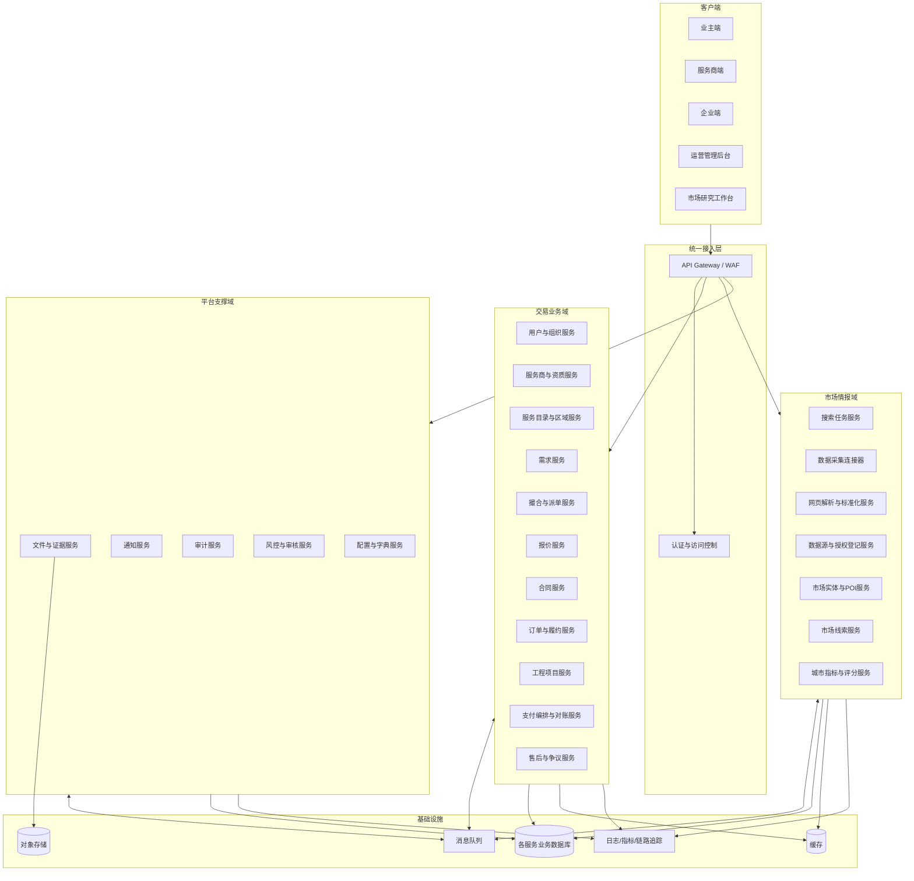

# 微服务系统架构设计

> 状态：建议方案 / v0.1，待业务边界、团队规模、云资源与首期范围评审  
> 更新时间：2026-11-20  
> 适用范围：中国大陆水电安装服务与工程交易平台  
> 上游文档：05 产品架构、06 业务规则与流程、07 数据架构、08 技术架构、11 市场研究与城市选择数据化体系  
> 核心决策：目标架构按领域微服务设计；首期不强制一次性拆成大量独立部署单元，采用模块化单体/少量服务先行，按成熟度逐步服务化。

## 1. 架构目标

本平台同时包含交易业务和市场情报两类能力：

1. **交易业务平台**：承载用户、组织、服务商、需求、报价、合同、订单、施工履约、验收、售后、支付协作。
2. **市场情报平台**：通过合法公开数据源、授权API和人工研究，采集城市、企业、服务商、POI、公开工程项目及市场线索，形成城市研究和运营决策能力。

两者属于同一产品体系，但数据责任和业务事实不同。市场情报系统发现的企业、商户或需求线索，不得自动成为已认证服务商、有效需求或真实订单。必须经过交易平台规定的实名/主体核验、用户授权、审核和业务流程。

架构目标：
- 领域边界清晰，交易核心与采集分析解耦。
- 服务可独立部署、扩缩容、发布和故障隔离。
- 核心交易数据由唯一权威服务负责写入。
- 通过API和事件协作，避免跨服务直接访问数据库。
- 关键操作支持幂等、审计、追踪、补偿和对账。
- 支持从单城市MVP逐步演进至多城市、多专业和长期百万DAU目标。
- 不以微服务数量作为架构成熟度指标，控制分布式事务和运维复杂度。

## 2. 总体逻辑架构



该图是逻辑边界图，不代表首期必须部署为图中每一个独立进程。数据库图示为逻辑上的服务数据所有权；MVP可物理共用数据库集群，但必须按模块/服务划分Schema、账号和访问边界，禁止跨域直接写表。

## 3. 微服务划分

### 3.1 交易核心域

| 服务 | 核心职责 | 主要数据所有权 | 关键接口/事件 |
|---|---|---|---|
| identity-service | 登录、认证凭证、会话、账户安全 | 用户凭证、会话、认证记录 | 登录、登出、账户状态变更 |
| organization-service | 个人/企业组织、成员、角色授权 | 组织、成员关系、授权策略 | 组织创建、成员邀请、权限变更 |
| provider-service | 服务商档案、技能、服务范围、准入审核 | 服务商档案、能力、资质核验结果 | 服务商申请、审核通过/拒绝 |
| catalog-service | 服务类目、计价单位、服务属性、区域字典 | 类目、服务项、区域基础字典 | 类目变更、区域配置更新 |
| demand-service | 需求创建、编辑、审核、发布和关闭 | 需求及其状态历史 | 需求发布、需求关闭 |
| matching-service | 推荐、邀请、派单、匹配结果 | 匹配任务、邀请记录 | 邀请服务商、匹配完成 |
| quotation-service | 报价提交、版本、比较、接受/拒绝 | 报价及报价版本 | 报价提交、报价接受 |
| contract-service | 合同主体、版本、签署状态、变更 | 合同、合同方、签署证据索引 | 合同待签、合同生效、合同变更 |
| service-order-service | 住宅订单、预约、施工、变更、验收 | 服务订单、施工记录、验收记录 | 开工、完工申请、验收通过 |
| project-service | 商业工程项目、标段/专业包、进度和签证 | 工程项目、项目包、进度申报 | 项目发布、节点申报、变更 |
| payment-service | 支付请求编排、退款、外部交易映射、结算对账 | 支付意图、外部交易、退款、对账差异 | 支付结果、退款结果、结算状态 |
| aftersales-service | 售后、投诉、争议、整改协商 | 售后案件、投诉、争议处理记录 | 售后创建、争议升级、处理完成 |
| review-service | 评价、服务反馈和信用事件 | 评价、信用事件 | 评价发布、评价审核 |

### 3.2 市场情报域

| 服务 | 核心职责 | 主要数据所有权 |
|---|---|---|
| research-source-service | 数据源目录、授权/条款、来源等级、访问限制和责任人 | 数据源登记、许可与采集策略 |
| search-orchestrator-service | 关键词计划、城市/区县任务、调度、限频和任务编排 | 搜索任务、任务计划 |
| collection-connector-service | 官方API、授权商业API、公开网页采集适配器 | 采集执行记录、连接器配置 |
| page-processing-service | 网页解析、正文提取、结构化抽取、版本化解析 | 原始文档索引、解析结果 |
| market-entity-service | 企业、服务商候选实体、去重、实体合并和来源关联 | 市场实体、实体来源关系 |
| market-poi-service | 地图POI、地址、坐标、地理区域和重复地点治理 | POI及地理索引 |
| market-signal-service | 需求线索、价格线索、竞争线索、工程项目信号 | 市场线索、线索状态 |
| city-intelligence-service | 城市指标、数据质量、评分快照、城市对比 | 城市指标和评分快照 |
| research-workbench-service | 研究人员任务、人工核验、访谈记录和研究结论 | 研究项目、人工核验记录 |

市场情报服务的采集范围必须受数据源登记和授权策略约束。连接器不允许绕过访问控制、验证码、登录权限或技术限制；不得默认抓取个人联系方式、身份证件等非必要个人信息。

### 3.3 平台支撑域

| 服务 | 核心职责 |
|---|---|
| api-gateway | API路由、认证上下文传递、限流、基础防护、版本路由 |
| notification-service | 站内信、短信、推送及发送重试 |
| file-evidence-service | 文件上传、病毒扫描、访问授权、证据归档和摘要校验 |
| audit-service | 管理操作审计、敏感操作留痕和审计查询 |
| risk-review-service | 内容/主体审核任务、风险规则、人工复核工作流 |
| configuration-service | 字典、业务参数、开关和可审计配置 |
| search-index-service（后续） | 面向交易端和运营端的全文检索索引，不作为核心交易事实库 |

认证和授权的逻辑可以由identity/organization能力协作完成；是否部署成单独IAM产品，待团队和安全要求确定。

## 4. 服务边界与数据所有权

必须遵循以下规则：

1. 一个业务实体有且只有一个权威写入服务。例如订单由service-order-service维护，支付交易由payment-service维护，合同由contract-service维护。
2. 其他服务需要数据时，通过服务API、事件订阅或只读查询投影获得，不直接更新其数据库。
3. 不共享可写业务表；物理数据库集群可以共用，但逻辑Schema、数据库账号和迁移责任按服务隔离。
4. 跨服务查询优先构建本地读模型或查询聚合层，避免页面请求同步扇出十几个服务。
5. 事件数据是事实变更通知，不应被消费者反向修改为生产者的权威状态。
6. 市场情报数据与交易数据分层存储。市场实体的“候选/待核验/已核验”状态不能替代交易平台的服务商准入状态。
7. 支付服务保存外部机构交易事实和业务支付状态映射，不提供平台自建资金余额或自由划转能力。

### 4.1 建议的数据存储

| 数据域 | 首期建议 | 规模化后可选 |
|---|---|---|
| 交易核心 | MySQL关系库，按服务Schema/账号隔离 | 按负载拆库、读副本、分区和归档 |
| 市场原始文档 | 对象存储保存依法可留存的原文/快照及摘要 | 对象存储分层、生命周期管理 |
| 市场结构化数据 | MySQL | 分析型数据库/数据仓库 |
| 地理检索 | MySQL空间索引或地图服务 | 专业地理检索引擎 |
| 全文搜索 | 首期关系库检索/外部搜索API | Elasticsearch/OpenSearch等 |
| 缓存 | Redis | Redis集群/托管缓存 |
| 异步事件 | 首期可选轻量消息队列或可靠任务表 | Kafka/RabbitMQ/RocketMQ等按团队能力选型 |
| 文件与施工证据 | 对象存储 + 元数据关系库 | CDN、分层存储和独立媒体处理 |

不建议MVP同时引入多种消息队列、多个关系型数据库和数据湖。选型应服从团队熟悉度、云厂商支持、成本和运维能力。

## 5. 核心服务调用关系

### 5.1 住宅交易链路

1. 客户端经API Gateway调用identity-service完成认证。
2. demand-service创建需求并执行字段、区域、内容和用户权限校验。
3. risk-review-service处理需要人工/自动审核的任务；审核通过后由demand-service发布需求事件。
4. matching-service订阅需求发布事件，结合catalog和provider服务数据生成候选服务商并发出邀请。
5. quotation-service接收服务商报价，保存报价版本。
6. 业主接受报价时，quotation-service校验报价仍有效，并通过领域命令协调合同创建；必须保证接受报价幂等，避免多方同时中选。
7. contract-service管理合同主体、合同版本和签署证据。
8. 合同满足生效条件后发布ContractEffective事件，service-order-service创建或激活履约订单。
9. service-order-service管理预约、开工、施工记录、变更、完工申请和验收。
10. payment-service依据合同付款计划及授权规则创建支付请求，调用持牌支付机构适配器。
11. 售后、评价和通知分别由对应服务处理。

以上是逻辑流程。实际采用同步命令还是事件驱动，应按一致性要求选择；不能把所有步骤都改成异步，导致用户无法获得明确交易结果。

### 5.2 市场数据采集链路

1. research-source-service登记数据源、授权依据、使用范围、访问频率和保留规则。
2. research-workbench-service或运营人员创建城市研究计划和关键词组。
3. search-orchestrator-service拆分城市、区县、主题、时间窗口和采集任务。
4. collection-connector-service根据数据源类型调用官方API、授权API或允许访问的公开网页。
5. page-processing-service保存必要原始材料索引，执行正文提取、结构化解析和版本化。
6. market-entity-service、market-poi-service、market-signal-service进行标准化、去重和关联。
7. research-workbench-service将低置信度、重复冲突或高影响实体提交人工核验。
8. city-intelligence-service按指标字典计算城市指标和评分快照。
9. 研究工作台展示来源、时间、样本量、缺失率、可信度和待核验项。

市场采集失败不能影响交易下单、合同和支付主链路。采集任务应有独立队列、限流、熔断和资源配额。

## 6. 事件驱动与消息规范

### 6.1 事件设计原则

- 事件描述已经发生的事实，命名使用过去式或明确事实语义。
- 每个事件包含event_id、event_type、occurred_at、producer、schema_version、aggregate_type、aggregate_id、aggregate_version、trace_id和必要业务字段。
- 事件不携带不必要的身份证号、手机号、精确住址、支付密钥等敏感信息。
- 消费者必须支持重复投递；同一event_id只能产生一次业务效果。
- 事件版本向前兼容；破坏性变化发布新版本。
- 关键事件需保留可追溯记录和失败重放机制。

### 6.2 建议事件目录

| 生产服务 | 事件示例 | 主要消费者 |
|---|---|---|
| demand-service | DemandPublished、DemandClosed | matching、notification、analytics |
| provider-service | ProviderVerified、ProviderSuspended | matching、risk、notification |
| matching-service | ProviderInvited、MatchCompleted | notification、analytics |
| quotation-service | QuotationSubmitted、QuotationAccepted | contract、notification |
| contract-service | ContractEffective、ContractChanged、ContractTerminated | service-order、payment、notification |
| service-order-service | WorkStarted、WorkCompleted、AcceptancePassed | payment、aftersales、review、analytics |
| payment-service | PaymentSucceeded、RefundSucceeded、SettlementUpdated | order、notification、reconciliation |
| aftersales-service | ComplaintCreated、DisputeResolved | notification、review、risk |
| collection-connector-service | CollectionCompleted、CollectionFailed | page-processing、research-workbench |
| page-processing-service | DocumentParsed、ParseFailed | market-entity、market-signal |
| market-entity-service | MarketEntityMerged、EntityVerificationRequired | research-workbench、city-intelligence |

事件仅作为跨服务通知。对于支付、合同、验收等关键状态，消费者必须按生产服务的权威状态或可验证外部机构结果进行必要核验。

### 6.3 可靠消息

建议采用Outbox Pattern：业务服务在本地事务中同时写入业务数据和待发布事件记录；独立发布器将事件发送到消息队列；消费者使用Inbox/幂等消费记录防止重复处理。消息失败进入重试和死信队列，并提供人工检查、修复和重放工具。

## 7. 分布式一致性与交易安全

禁止以跨服务数据库事务或分布式锁作为默认一致性方案。

- **本地强一致：** 单个服务内部的状态转换、金额校验、唯一约束和版本控制在本地数据库事务中完成。
- **跨服务最终一致：** 使用领域事件、状态机、超时检查和补偿动作。
- **Saga：** 仅用于确有多服务长流程的业务；每一步有明确成功条件、超时和补偿定义。
- **支付：** 超时状态为“结果未知/处理中”，不能直接判定失败；主动查询外部机构，回调验签和幂等处理。
- **报价接受：** 通过唯一约束、版本校验和单一命令入口避免重复选中。
- **合同签署：** 保存合同版本摘要、签署主体、签署结果和可信证据，不只存布尔值。
- **验收：** 验收结论由授权主体按业务规则提交，关键附件和整改过程留痕。
- **数据修复：** 使用可审计的补偿命令，不允许直接改库掩盖业务异常。

## 8. API Gateway与内部通信

### 8.1 外部入口

API Gateway负责路由、TLS终止（按部署方案）、认证上下文校验、限流、请求大小限制、基础防护、版本路由和请求ID生成/传递。Gateway不承载复杂业务规则，也不成为所有业务数据的持久化中心。

### 8.2 内部通信

- 同步HTTP/gRPC：用于需要立即返回结果、边界清晰的命令或查询。
- 消息队列：用于通知、索引、采集、异步审核、统计和跨域事件。
- 服务间身份：采用服务身份凭证和最小权限，不能仅凭内网可达就信任调用方。
- 超时、重试和熔断：必须设置合理上限；非幂等命令不能盲目重试。
- 服务发现：MVP可使用云平台内网DNS/服务地址；服务规模扩大后再评估注册中心或服务网格。

### 8.3 BFF与查询聚合

业主端、服务商端、企业端和运营端可能需要不同的数据组合。可在客户端规模和复杂度上升后引入BFF或查询聚合服务，负责视图聚合和读模型，不负责取代领域服务的业务写入权。

## 9. 安全、隐私与市场数据合规

- 统一身份认证，但按服务和资源实施细粒度授权。
- 服务间调用使用独立服务身份、密钥轮换和网络隔离。
- 外部数据源登记授权依据、许可条款、用途、采集频率和留存期限。
- 遵守网站服务条款、API协议、robots约定及适用法律，不绕过登录、验证码、付费墙、访问控制或反爬措施。
- 不默认采集个人联系方式、身份证件、私人地址等信息；研究分析优先使用企业公开信息和聚合指标。
- 原始网页/响应的留存必须有合法依据，并设置最短必要保存期限。
- 对采集结果标注来源、采集时间、解析版本、置信度和人工核验状态。
- 个人信息处理、公开信息合理使用、数据出境、网络安全及行业资质等问题需由法律专业人员结合实际场景确认。
- 支付服务边界按04文档执行；微服务拆分不改变平台与支付机构的法律责任和资金边界。

## 10. 可观测性与运维治理

所有服务统一采用：
- 结构化日志：timestamp、service、env、request_id、trace_id、actor_id（内部标识）、business_id、error_code。
- 指标：请求量、错误率、延迟P50/P95/P99、CPU/内存、连接池、队列堆积、任务成功率。
- 分布式追踪：跨Gateway、服务调用、消息消费和外部机构请求传递trace_id。
- 审计：管理后台敏感操作、主体核验、合同状态、支付退款和数据导出。
- 告警：核心交易失败、支付未决堆积、消息死信、采集异常、数据库容量、备份失败。
- 发布治理：服务独立版本、兼容性检查、灰度发布、回滚预案和数据库迁移审查。

市场采集域单独监控抓取成功率、来源限频、解析失败率、重复率、过期率和来源可用性；不得让其噪声淹没交易核心告警。

## 11. 部署拓扑与演进阶段

### 阶段A：MVP——模块化单体 + 独立采集Worker

建议部署：
- 一个交易后端应用，内部按领域模块严格分层。
- 一个市场研究/采集应用，内部拆分调度器、连接器和解析Worker。
- 一个独立异步任务/消息组件（或可靠任务表，按团队能力）。
- MySQL、Redis、对象存储、统一日志监控。
- API Gateway/反向代理。

此阶段不必将identity、demand、order、payment等全部拆成独立服务。交易核心保持单体部署，但领域边界和数据访问规则按未来微服务设计。

### 阶段B：业务增长——先拆异步和资源隔离型服务

优先候选：
1. collection-connector与page-processing：采集任务资源波动大，适合独立扩缩容。
2. notification-service：外部短信/推送波动不能影响交易请求。
3. file-evidence-service：文件上传、扫描、转码和下载带宽需要独立资源管理。
4. search-index-service：搜索索引可异步构建，不影响交易主库。
5. payment-provider-adapter：支付外部依赖需要独立安全边界和运维监控，但支付业务状态仍由payment域负责。

### 阶段C：多城市——按业务边界拆核心服务

在团队、流量和运维能力成熟后，考虑拆分identity/organization、provider、demand/matching/quotation、contract/order、payment、aftersales等领域服务。优先依据独立扩缩容、发布频率、故障隔离和数据所有权，而非平均拆分。

### 阶段D：全国规模——分析平台和多区域能力

当数据规模和分析需求确实需要时，再建设数据仓库/湖仓、流式计算、搜索集群、地理检索服务、多区域容灾和更成熟的服务治理。跨区域部署需单独考虑数据同步、个人信息保护、支付机构覆盖、容灾和运营组织。

## 12. 容量与弹性设计

不能由“100万DAU”直接推导服务实例数量。应分别测量：
- Gateway的峰值请求、连接数和TLS开销。
- 交易写服务的并发命令、锁冲突和事务耗时。
- 查询服务的读写比例、缓存命中率和查询复杂度。
- 市场采集的来源数、任务频率、每页大小、解析CPU和限频约束。
- 文件服务的上传量、平均文件大小、下载带宽和扫描耗时。
- 消息系统的事件速率、堆积时间和消费恢复能力。

弹性原则：
- 无状态API服务优先水平扩容。
- 采集Worker按来源限频和队列积压弹性扩缩。
- 对外部API设置并发上限、熔断和退避重试。
- 数据库先优化索引、SQL、缓存和读模型，再考虑分库分表。
- 对任务队列设置优先级和资源配额，市场采集不能抢占核心交易资源。
- 压测使用真实业务比例和峰值模型，记录瓶颈及成本。

## 13. 技术选型建议

以下是候选方向，不是已锁定决策：

| 能力 | 候选技术/方案 | 选择原则 |
|---|---|---|
| 服务端 | Java + Spring Boot（若团队以Java为主） | 团队熟悉度、生态和招聘能力 |
| API | REST/JSON；内部高频场景可评估gRPC | 优先可调试和契约清晰 |
| 数据库 | MySQL | 交易关系数据和团队维护能力 |
| 缓存 | Redis | 热点查询、短期状态和限流 |
| 消息 | RabbitMQ/RocketMQ/Kafka择一 | 按消息模型、运维成本和团队经验选 |
| 对象存储 | 兼容S3或云厂商对象存储 | 文件私有访问、生命周期、合规区域 |
| 搜索 | 首期关系库/外部搜索；后续OpenSearch/Elasticsearch | 数据规模和全文检索需求 |
| 容器 | Docker；规模化后可评估Kubernetes或云托管容器 | 不为MVP增加不必要集群运维 |
| 可观测性 | OpenTelemetry + Prometheus/Grafana + 集中日志 | 统一trace、指标和告警 |
| Web采集 | Python Worker/任务调度 + 官方API连接器 | 连接器隔离、可测试、来源限频和解析版本管理 |

不要同时引入多个同类中间件。所有技术选择应有ADR记录，包括问题、备选方案、成本、风险和回退策略。

## 14. 服务目录与代码仓库建议

初期可采用单仓库或少量仓库。建议先按领域模块组织代码，待独立发布需求明确后再拆仓库。

单仓库示意：

```text
platform/
  apps/
    transaction-api/
    market-research-api/
    collection-worker/
    notification-worker/
  modules/
    identity/
    organization/
    provider/
    catalog/
    demand/
    matching/
    quotation/
    contract/
    service-order/
    project/
    payment/
    aftersales/
    market-source/
    market-entity/
    market-signal/
    city-intelligence/
    file-evidence/
    audit/
  contracts/
    openapi/
    events/
  deploy/
    local/
    staging/
    production/
  docs/
```

这是逻辑目录建议。若采用多仓库，应保持API契约、事件Schema、版本策略和发布流程统一。

## 15. 关键架构决策记录

| 决策项 | 当前建议 | 状态 |
|---|---|---|
| 目标架构 | DDD领域边界 + 微服务 | 建议 |
| MVP部署形态 | 交易模块化单体 + 独立市场采集Worker | 建议 |
| 市场采集与交易业务 | 独立部署、独立数据域，通过API/事件集成 | 建议 |
| 数据库所有权 | 服务级逻辑隔离，禁止跨服务写表 | 建议 |
| 跨服务通信 | 同步API + 事件驱动，按一致性要求选择 | 建议 |
| 消息可靠性 | Outbox/Inbox、幂等、重试和死信处理 | 建议 |
| 交易资金 | 持牌机构处理资金，平台服务只编排和核对业务状态 | 必须遵守既定合规边界，具体方案待专业确认 |
| 服务治理 | MVP先统一日志、指标、trace和配置，不强制服务网格 | 建议 |
| 技术栈 | Java/Spring Boot交易服务；Python采集Worker为候选 | 待团队确认 |
| 容器编排 | MVP按实际部署复杂度选择，规模化再评估集群编排 | 待确认 |

## 16. 实施顺序与验收标准

### 第一步：先建立领域边界
- 输出服务上下文图、核心实体所有权表。
- 为每个服务定义职责、API、事件和禁止事项。
- 确认住宅订单与商业工程项目的边界。

验收：任意核心数据实体均能指出唯一权威写入方；不存在跨域直接写表设计。

### 第二步：建立MVP部署形态
- 交易模块化单体。
- 市场研究API和采集Worker独立运行。
- 建立统一认证、日志、trace、任务重试和审计。
- 建立服务级配置和数据访问隔离。

验收：采集Worker停止或过载时，交易创建、报价、合同和订单链路仍可用。

### 第三步：建立跨域事件机制
- 定义事件Schema和版本规则。
- 实现Outbox/Inbox或等效可靠消息机制。
- 实现重复消息、失败重试、死信和人工重放。

验收：模拟重复、乱序、延迟和服务重启，不能造成重复订单、重复支付请求或状态倒退。

### 第四步：按瓶颈拆分服务
- 使用监控数据确定拆分候选。
- 明确服务数据库所有权、迁移方案和回滚策略。
- 先拆异步、文件、通知和采集等资源隔离收益明显的服务。

验收：拆分后故障范围缩小，独立发布和扩缩容有可测量收益，整体运维复杂度可控。

## 17. 待确认事项

1. 首期研发团队规模、Java/Python能力和运维责任人。
2. 首期云厂商、部署区域、预算和数据存储要求。
3. 交易平台首期是否仅住宅服务，商业工程先做线索还是进入真实交易。
4. 市场数据采集源清单、授权方式、采集频率和保留策略。
5. 支付机构产品、商户主体和对账接口。
6. API Gateway、消息队列、对象存储和可观测性产品选型。
7. 目标RPO/RTO、可用性目标和发布窗口。
8. 服务拆分触发阈值和团队值班能力。

**结论：** 目标上按微服务边界设计，实施上采用渐进式服务化。交易核心与市场情报必须隔离；先用模块化单体保证交易一致性，再把采集、通知、文件、搜索等独立资源域拆出，最后依据真实业务负载拆分交易核心服务。
